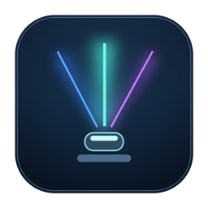
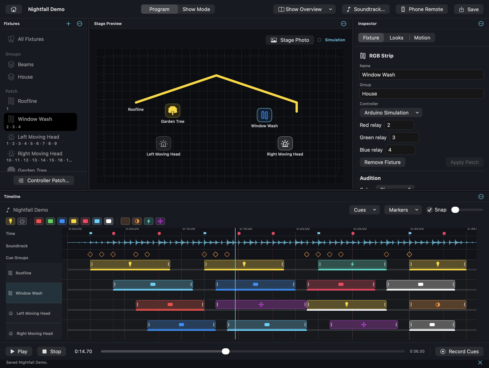
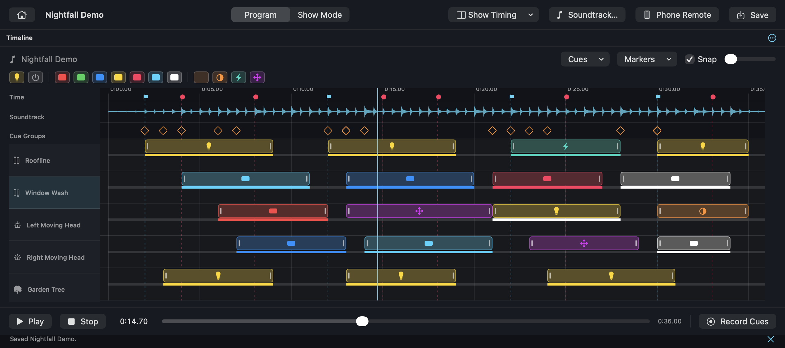

  
  <h1>Light Show Studio</h1>
  
<strong>Lay out your lights, program them to music, and rehearse the show on your Mac.</strong>

  
<a href="https://github.com/Chosencode25/light-show-studio/releases/latest"><strong>Download for Mac</strong></a> · <a href="https://github.com/Chosencode25/light-show-studio/releases/download/v0.3/Nightfall-Demo-lightshow.zip">Sample show</a> · <a href="docs/GETTING_STARTED.md">Quick start</a> · <a href="docs/BUILD_HISTORY.md">Build archive</a>

  
v0.3 · macOS 15 or later · Apple Silicon and Intel

## What you can do

| Design the stage | Program the show | Run a rehearsal |
| --- | --- | --- |
| Place moving heads, switched plugs, and RGB strips on a stage photo. Trace a roofline with an adjustable strip path. Save reusable fixture setups. | Drop power, color, and effects onto fixture rows. Trim clips, snap to markers, and edit fixtures right from the stage or timeline. | Arm Show Mode, run cues and blackout in Simulation, or pair a phone on the same Wi-Fi network to control playback. |

## A timeline for every fixture

**Show Timing** gives the soundtrack waveform and fixture rows the full editor. Switch to **Cue Editing** when you want the stage, timeline, and inspector side by side. Use **Window → Layouts** to switch between all five presets, or dock and resize panels to make your own arrangement.

## Get started

1. Download the universal ZIP from the [latest release](https://github.com/Chosencode25/light-show-studio/releases/latest), unzip it, and move **Light Show Studio.app** to **Applications**.
2. Start a **New Light Show**, add fixtures, and choose a soundtrack.
3. Drag **On** onto a fixture’s timeline row. New clips start at five seconds. Drag either edge to change the length, or drag the center to move the clip.
4. Open **Show Mode**, choose **Check & Arm**, then press **Play** to rehearse.

**Try Nightfall Demo.** Download the [sample show](https://github.com/Chosencode25/light-show-studio/releases/download/v0.3/Nightfall-Demo-lightshow.zip), unzip it, and open **Nightfall Demo.lightshow**. The project includes the original demo soundtrack, a traced roofline, five fixtures, and a programmed timeline.

Fixture output currently runs in **Simulation**. The downloadable app is ad-hoc signed and distributed without Apple notarization.

## Documentation

| Guide | Covers |
| --- | --- |
| [Create and run a show](docs/GETTING_STARTED.md) | Fixture setup, looks, cue recording, and rehearsal |
| [Design and edit](docs/DESIGN_TOOLS.md) | Stage photos, fixture settings, timed clips, and panel layouts |
| [Phone remote and updates](docs/PHONE_AND_UPDATES.md) | Local pairing, playback controls, and version checks |
| [Build history](docs/BUILD_HISTORY.md) | Original downloads and source tags |
| [Project chat commands](docs/CHAT_COMMANDS.md) | One-word requests for the coding agent |

Inside the app, press **⌘/** to search keyboard shortcuts.

## Build from source

Open `LightShowStudio.xcodeproj` in **Xcode 27.0 beta 5 (27A5237l)**, choose the **LightShowStudio** scheme, and run or test it. The app uses SwiftUI and AppKit and targets macOS 15 or later. See the [development notes](docs/FIRST_MILESTONE.md) and [verification history](docs/PROGRESS.md).
